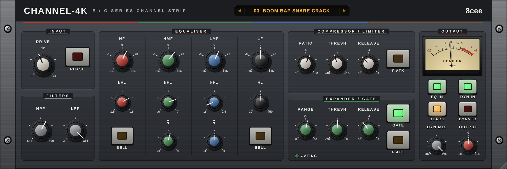
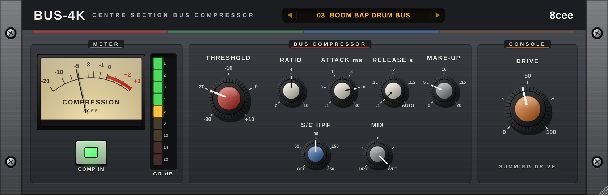
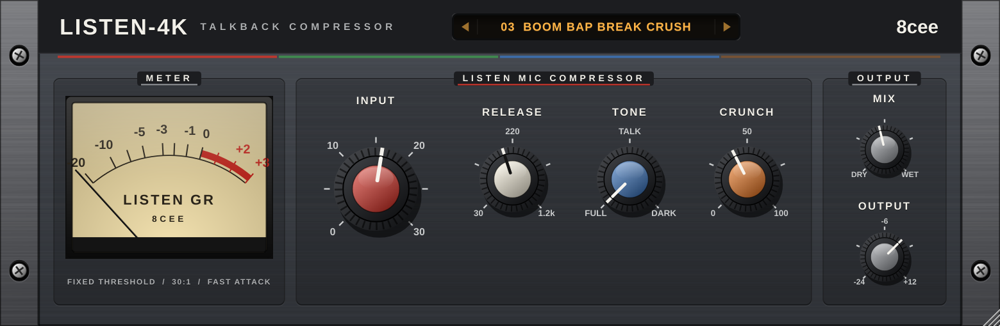

# 8cee Console 4K — Channel-4K · Bus-4K · Listen-4K

A large-format-console style bundle by **8cee**, voiced for **90s NY boom bap, new jack swing, conscious hip hop and R&B**. Built with JUCE: Windows VST3 (plus a standalone app).

Inspired by the classic 4000 E/G-series desks that most of those records went through. Not affiliated with or endorsed by Solid State Logic.

| | |
|---|---|
|  | **Channel-4K — E/G channel strip.** Drive (console line-stage saturation, level-compensated), polarity, 18 dB/oct HPF and 12 dB/oct LPF. 4-band EQ with **BROWN (E)** and **BLACK (G)** curves: Black has proportional Q on the mids and the shelf dip/overshoot; LF and HF switch to bells. Compressor/limiter with auto make-up, fast attack, ratio 1:1 to limit. Expander/gate with range, fast attack and a gating LED. Dynamics pre/post EQ, dynamics mix (parallel compression right in the strip), output. |
|  | **Bus-4K — centre-section bus compressor.** Threshold, ratio 2/4/10, attack .1–30 ms, release .1–1.2 s or AUTO, make-up, sidechain HPF, mix, plus **Console Drive**: the summing amp's crosstalk and saturation. VU and LED gain-reduction meters. |
|  | **Listen-4K — talkback (listen mic) compressor.** The desk's fixed, brutal room-mic crusher: fixed threshold, 30:1, near-instant attack. Input pushes into it, variable release, tone (Full / Talkback / Dark), crunch, mix and output. |

All three run at 2× oversampling, use linked stereo detection, and have a resizable vector UI (50–200 %). Double-click any knob to reset it.

## Presets

Click the amber display for the list, or step with the arrows / mouse wheel. Your DAW sees them as programs too.

| Channel-4K | Bus-4K | Listen-4K |
|---|---|---|
| Init | Init | Init |
| Boom Bap Kick Thump | 90s NY Mix Bus | Room Mic Explosion |
| Boom Bap Snare Crack | Boom Bap Drum Bus | Boom Bap Break Crush |
| Dusty Break Loop | Breakbeat Pump | Parallel Kit Smash |
| NY Parallel Drum Smash | NY Parallel Crush | Snare Room Bloom |
| Hats & Shaker Tame | New Jack Drum Snap | Dusty Loop Pump |
| Jazz Upright Bass Sample | New Jack Mix Shine | Hat Bleed Grit |
| New Jack Synth Bass | Conscious Mix Glue | Lo-Fi Telephone Vox |
| New Jack Kick Punch | R&B Vocal Bus | Ad-Lib Thickener |
| New Jack Gated Snare | R&B Ballad Master | New Jack Clap Slam |
| NY Rap Vocal Upfront | Sample Chop Glue | Dark Vinyl Kick Room |
| Conscious Vocal Warm | Music Bus (Under Vocal) | Gentle Room Lift |
| R&B Lead Vocal Silk | Master Loud 96 | |
| R&B Background Stack | Console Colour Only | |
| Rhodes & Keys Sample | | |
| Soul Horn Stab Chop | | |
| DJ Scratch Cuts | | |
| Vinyl Sample Cleanup | | |

A typical chain: **Channel-4K** on each drum, sample and vocal track → **Listen-4K** in parallel on the drum bus → **Bus-4K** on the drum bus and the mix bus.

## Download a build

Every push runs `.github/workflows/build.yml` on GitHub: a Windows build, checked with **pluginval**. Get it under **Actions → latest run → Artifacts** (`8cee-Console-4K-Windows`).

## MPC standalone (VST2, Linux ARM)

All three also build as native MPC OS insert effects (Gen1 armv7 and Gen2 aarch64) with the same presets: see [mpc/README.md](mpc/README.md).

## Install

Copy the `.vst3` folders to `C:\Program Files\Common Files\VST3\`.

Then rescan plug-ins in your DAW (in MPC: Preferences → Plugins → Rescan).

## Build it yourself

CMake 3.22+ and a C++17 compiler (Visual Studio 2022). JUCE 8.0.4 is downloaded automatically.

```bash
cmake -S . -B build -DCMAKE_BUILD_TYPE=Release
cmake --build build --config Release --parallel
```

## Project layout

```
shared/            DSP helpers, processor + preset boilerplate, vector UI kit, console widgets (EceeConsoleUI.h)
plugins/Channel4K  channel strip
plugins/Bus4K      bus compressor
plugins/Listen4K   talkback compressor
tools/             dev-only: renders each UI to PNG and prints a level/THD/preset report (-DECEE_BUILD_TOOLS=ON)
```

## Before you sell them

JUCE 8 is dual-licensed (AGPLv3 or a JUCE licence); selling closed-source plug-ins needs a JUCE licence. Plug-in codes: manufacturer `Ecee`, plug-ins `Ch4k`, `Bs4k`, `Ls4k` — keep them fixed once released.
